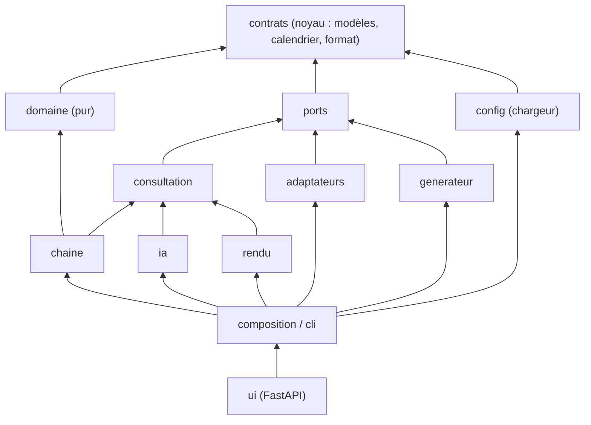
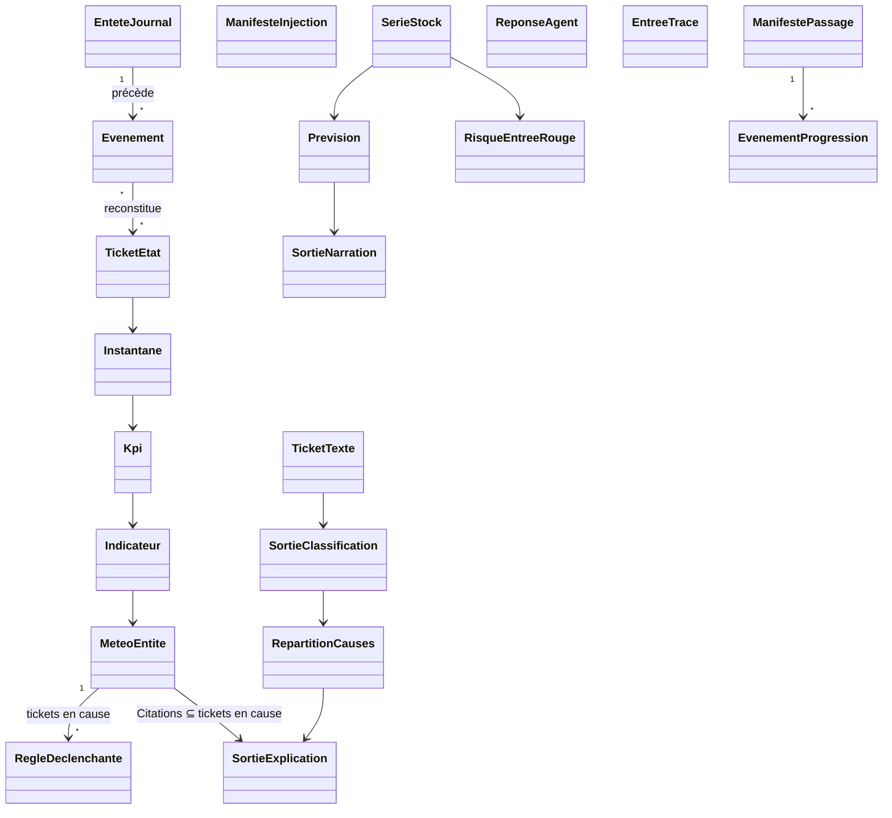
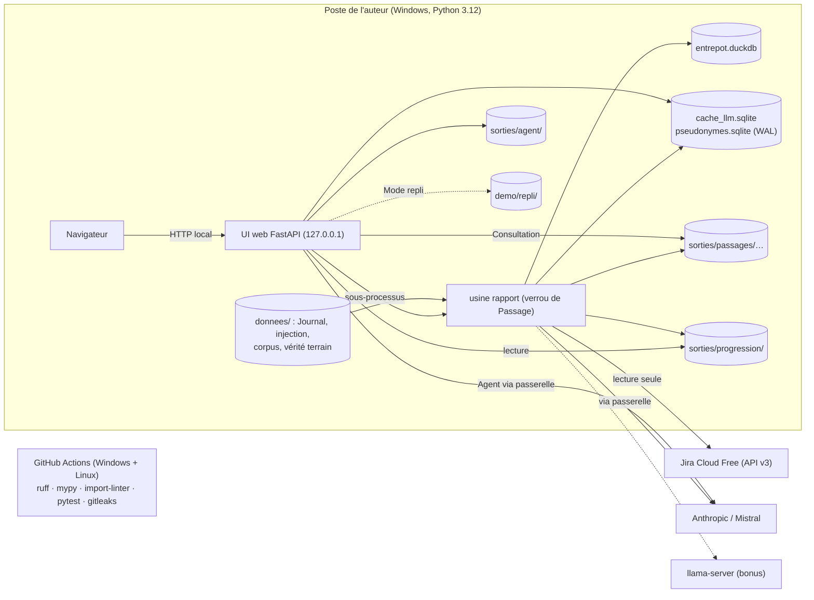
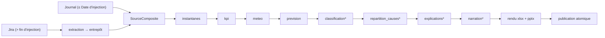
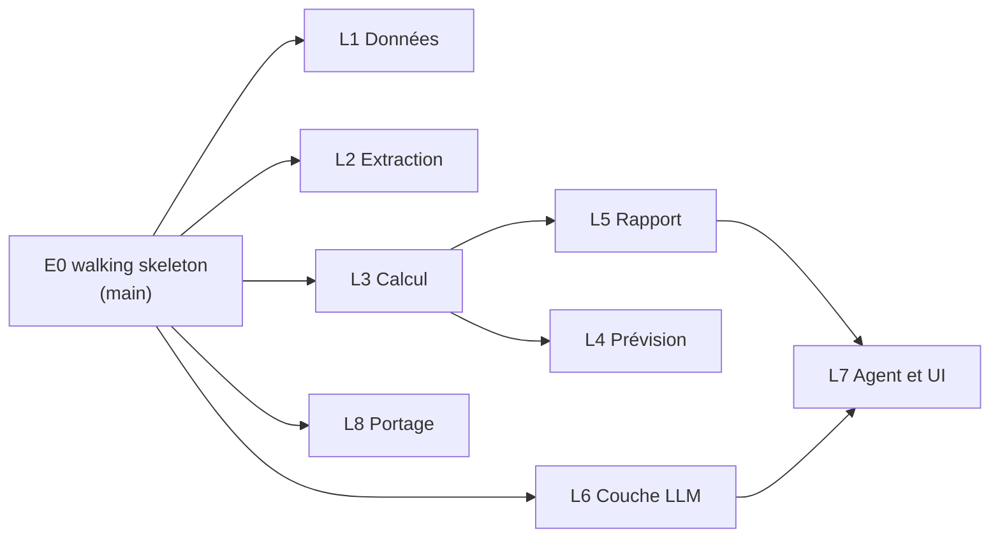

# Spine d'architecture : usine-migration-jira-demo

Vocabulaire : celui du Glossaire du PRD (§ 3). Les `[HYPOTHÈSE H-n]` sont suivies dans `docs/QUESTIONS.md`.

## Paradigme

**Hexagonal (ports et adaptateurs) autour d'une chaîne pipes-and-filters.** Le domaine est pur : des fonctions sans I/O, sans horloge et sans hasard. Les ports sont des `typing.Protocol`, les adaptateurs les implémentent, et seule la racine de composition les instancie et câble les étapes. La Chaîne de reporting exécute un registre d'étapes. Elle est la seule à écrire dans le Passage en cours. **Contract-first** : `usine.contrats` (contrats, calendrier, formatage) et `usine.ports` sont figés à la fin de l'epic E0 (étiquette git `contrats-v1`), avant l'ouverture des lanes en worktrees.

| Couche | Paquet (`src/usine/`) | Peut importer | Externes permis en plus du socle |
| --- | --- | --- | --- |
| Noyau partagé | `contrats/` (modèles, schémas, `calendrier`, `format`, `versions`) | — | — |
| Ports | `ports/` | contrats | — |
| Domaine | `domaine/` | contrats | — (stdlib sans I/O, horloge ni hasard) |
| Consultation | `consultation/` | contrats, ports | — |
| Application | `chaine/` | contrats, ports, domaine, consultation | — |
| Application | `ia/` | contrats, ports, consultation | — |
| Application | `rendu/` | contrats, ports, consultation | openpyxl, python-pptx |
| Adaptateurs | `adaptateurs/` | contrats, ports | httpx, duckdb, pydantic-ai-slim (avec `anthropic`, `mistralai`), presidio-analyzer, presidio-anonymizer, spacy, pymongo |
| Générateur | `generateur/` | contrats, ports | — |
| Configuration | `config/` (chargeur) | contrats | pyyaml, pydantic-settings |
| Racine de composition | `composition.py`, `cli.py`, `*/cli.py` | tout | tout ; typer pour les modules `cli` |
| Interface | `ui/` | contrats, consultation, composition | fastapi, uvicorn, markdown-it-py |
| Hors produit | `evaluation/`, `evals/`, `outils/` (racine du dépôt) | contrats, ports, domaine, composition | tout |

**Liste blanche des externes.** Le socle de toute couche est pydantic, polars et la bibliothèque standard. Toute autre dépendance directe du projet (groupes compris, et `anthropic`, `mistralai` tirés par les extras de `pydantic-ai-slim`) est interdite à une couche qui ne la nomme pas. Le domaine n'importe pas non plus `io`, `os`, `pathlib`, `random`, `secrets`, `shutil`, `socket`, `sqlite3`, `subprocess`, `tempfile`, `time`, `urllib` ni `uuid` (AD-1, AD-9). `tests/depot/test_import_linter.py` vérifie que chaque dépendance directe est classée.

## Invariants et règles



Une flèche signifie « importe », et elle est transitive vers le bas (tout paquet peut importer `contrats`). Le tableau des couches fait foi. Il est recopié tel quel dans `[tool.importlinter]` (contrats `layers` et `forbidden`, colonne des externes comprise), et vérifié en CI.

### AD-1 : Hexagonal, racine de composition unique

- **Binds :** all
- **Prevents :** un module métier qui instancie un client Jira, DuckDB ou LLM et devient impossible à tester sans réseau (NFR-7).
- **Rule :** seuls `composition.py` et les modules `cli` importent `usine.adaptateurs`. Le domaine n'importe ni I/O, ni `datetime.now`, ni `random` : la Date d'arrêté et la graine sont passées en paramètre. `import-linter` refuse toute importation absente du tableau des couches. La composition de `usine rapport` ne lit jamais `JIRA_TOKEN_INJECTION`.

### AD-2 : Contrats d'abord, propriétaire unique

- **Binds :** all ; contrats listés sous *Contrats v1*
- **Prevents :** deux lanes qui définissent chacune leur forme d'Instantané, de Météo, de sortie LLM ou de fichier.
- **Rule :**
  - **Source unique.** Toute forme qui franchit une frontière de paquet ou de fichier est définie dans `usine.contrats`, et nulle part ailleurs. Cela vaut aussi pour les enveloppes des fichiers JSON d'un Passage, pour les signatures et résultats des outils de l'Agent, pour la valeur persistée par un cache (`EnveloppeCache`), pour le schéma de réponse demandé au fournisseur LLM (`Reponse<Tache>`, AD-12) et pour les données que la composition passe à la Chaîne (`DonneesPassage`). Tout `Protocol` implémenté hors de son paquet est un port de `usine.ports`.
  - **Formes locales consignées.** Deux `Protocol` restent locaux, par décision du 12/10/2026 (D1) : `TablePseudonymes` (AD-15), interne aux adaptateurs de la lane L6, et `LectureMeteo` (AD-11), vue structurelle de `Consultation` dans `ui`. Aucune autre exception.
  - **Trois familles.**
    - Les enregistrements unitaires sérialisés sont des modèles Pydantic `frozen=True` (base `Enregistrement`, `extra="forbid"`). Leurs `Mapping` sont figés en `MappingProxyType` après validation, par un type annoté commun, sans changer la forme JSON ou YAML.
    - Les données tabulaires sont des `polars.DataFrame`, décrits par une constante `SCHEMA_<NOM>` (`SchemaTable`) et validés par `contrats.valider(df, SCHEMA_<NOM>)` à chaque frontière : colonnes, types et colonnes non nulles (`SchemaTable.non_nulles`).
    - Les objets en mémoire jamais sérialisés, qui portent un port, un `DataFrame` ou un `Callable` (`ContextePassage`, `ResultatEtape`, `DonneesPassage`, `OutilAgent`, `SchemaTable`), sont des `@dataclass(frozen=True)`. Pydantic n'y apporterait aucune validation utile.
  - **Version.** Chaque fichier d'un Passage porte `contrats_version`. `Consultation` refuse un Passage dont la version majeure diffère.
  - **Modification.** `contrats/` et `ports/` ne se modifient que sur `main`, par une PR dédiée qui incrémente `CONTRATS_VERSION`. Une lane ne touche jamais à ces deux répertoires, elle se rebase. Le port `Consultation` est gelé à E0-9 avec toutes les lectures exigées par FR-17, FR-19, FR-26, FR-27, FR-39, FR-43 à FR-46 et les prompts.

### AD-3 : Événement canonique unique

- **Binds :** FR-2, FR-6, FR-7, FR-8, FR-10, FR-49
- **Prevents :** un Journal au format changelog Jira face à un adaptateur qui normalise autrement, d'où des Instantanés différents selon la source.
- **Rule :**
  - **Contrat.** Toutes les sources produisent le contrat `Evenement` : `id_evenement`, `cle_ticket`, `type_ticket`, `horodatage` (UTC), `nature` ∈ {creation, transition, modification_champ, alignement}, `champ` (énumération `Champ`, AD-23), `de`, `vers`, `source`.
  - **Création.** Une création est suivie, au même horodatage, d'un `modification_champ` par attribut initial, titre et description compris.
  - **Journal.** C'est un fichier JSONL de `Evenement`, précédé d'un `EnteteJournal` (graine, date de génération, Date d'injection, version et modèle du Corpus). Le Journal n'est jamais au format Jira.
  - **Identifiants déterministes.**
    - `J-<rang>` pour le Journal ;
    - `<id changelog>-<rang item>` pour le changelog Jira ;
    - `C-<id ticket Jira>` pour une création Jira ;
    - `A-<cle>-<champ>-<sha8(vers)>` pour un alignement.

    Le dédoublonnage se fait sur `id_evenement`. Les Instantanés ne se calculent qu'à partir d'un flux d'`Evenement`.

### AD-4 : Source composite et coupure d'injection

- **Binds :** FR-5, FR-8, FR-49, FR-29
- **Prevents :** les transitions jouées par l'injecteur, comptées comme de vraies Entrées et Sorties ; une coupure lue tantôt en date, tantôt en instant ; des Citations à clés générées face à des liens à clés Jira.
- **Rule :**
  - **Méthode d'injection.** L'injection passe uniquement par l'API REST : tickets créés dans un ordre déterministe, puis amenés à leur état à la Date d'injection. L'import CSV est écarté, car il exige l'assistant d'administration manuel et contredit FR-5.
  - **Manifeste.** L'injecteur écrit `donnees/injection/manifeste_injection.json` (`ManifesteInjection` : Date d'injection, `debut_injection`, `horodatage_fin_injection`, `correspondance_cles`, clé de projet).
  - **Coupure.** Elle se fait par instants. `SourceComposite` prend tout le Journal (qui s'arrête à la Date d'injection), puis les seuls événements Jira dont `horodatage > horodatage_fin_injection`. Les événements Jira de l'intervalle d'injection sont ignorés, et aucune modification manuelle de Jira n'est faite pendant une injection. `created` et `resolutiondate` de Jira ne servent jamais avant `horodatage_fin_injection`.
  - **Clés.** La clé canonique en aval est la clé Jira. La correspondance est appliquée à la lecture du Journal.
  - **Jira fait foi.** Si l'état rejoué d'un ticket diffère de son état Jira, l'étape `extraction` persiste une seule fois, dans l'entrepôt, un `Evenement` `alignement` horodaté à sa première détection (décision du 10/10/2026, H-27). Le nombre d'alignements figure au manifeste du Passage.
  - **Cohérence (FR-49).** L'adaptateur convertit l'état Jira juste après injection en `Evenement` `alignement`. Le domaine calcule ensuite les deux Instantanés à la Date d'injection, à comparer.

### AD-5 : Écriture Jira réservée à l'injecteur

- **Binds :** FR-5, FR-9, FR-41
- **Prevents :** une écriture accidentelle dans Jira. Les POST de lecture (`search/jql`, `changelog/bulkfetch`) rendent inopérant un simple filtre « GET seulement ».
- **Rule :**
  - **Transport commun.** `adaptateurs/jira_http` (pagination, authentification Cloud et DC, reprise sur 429 avec `Retry-After`) ne sert qu'à ce rôle.
  - **Lecture.** `ClientJiraLecture` refuse toute requête hors d'une liste blanche `(méthode, gabarit de chemin)` et utilise `JIRA_TOKEN_LECTURE`. Un test de contrat vérifie la liste blanche sur Cloud et sur DC.
  - **Écriture.** Seul `generateur/injecteur` construit un client d'écriture, avec `JIRA_TOKEN_INJECTION`.
  - **Agent.** Il n'a aucun accès à Jira.

### AD-6 : Entrepôt d'extraction, écrivain unique, verrou de Passage

- **Binds :** FR-6, FR-7, FR-49
- **Prevents :** un repère de dernier Passage avancé après une extraction partielle ; deux processus qui écrivent la même base.
- **Rule :**
  - **Entrepôt.** `donnees/entrepot.duckdb` stocke les `Evenement` extraits de Jira (alignements compris) et le repère d'extraction. Seule l'étape `extraction` l'ouvre, à l'intérieur de `usine rapport`. L'UI ne l'ouvre jamais.
  - **Validation atomique.** Les événements et le repère sont validés dans une même transaction, après succès complet.
  - **Verrou.** `usine rapport` prend le verrou exclusif `donnees/.verrou-passage` et échoue proprement, en le nommant, s'il est déjà pris.
  - **Incrémental.** Extraction de `updated >= repère − marge` (marge dans `config/jira.yaml`), puis dédoublonnage par `id_evenement`.

### AD-7 : Passage immuable et autoportant

- **Binds :** FR-14, FR-25, FR-39, FR-45, FR-26, FR-27, FR-44
- **Prevents :** un Rapport quotidien partiel déposé ; un Mode repli qui lit un état à moitié réécrit ; un Rejeu ancien affiché comme le jour courant.
- **Rule :**
  - **Construction et publication.** Le Passage se construit dans `sorties/passages/.en-cours-<passage_id>/`, puis se publie par un seul renommage vers `sorties/passages/<date_arrete>/<passage_id>/` quand toutes les étapes ont réussi.
  - **Échec.** Le Passage est déplacé sous `sorties/echecs/`, sans fichier de rapport, avec un code de sortie non nul et l'étape fautive nommée.
  - **Immuabilité.** Un Passage publié n'est jamais modifié.
  - **Autoportance.** Les sorties déterministes (Tickets, Instantanés, KPI, Indicateurs, Météo, Prévisions et Risques) couvrent chaque Jour ouvré ≤ la Date d'arrêté. Les sorties LLM ne portent que sur la Date d'arrêté du Passage.
  - **Dernier Passage réussi.** C'est le maximum de `(date_arrete, horodatage_fin)`, déterminé seulement par `consultation.dernier_passage()`. Aucun pointeur mutable. `dernier_passage(sans_classification_initiale=True)` écarte les Passages qui ont fait la classification initiale (mesure de FR-44, AD-8).
  - **Identifiant.** `passage_id` = `AAAAMMJJTHHMMSSZ-<6 hex>`.
  - **Rejeu (FR-14).** Le rendu est déterministe : `docProps` fixés à partir de la Date d'arrêté, ordre stable. Le test compare les tables Parquet en entier, les JSON et JSONL, les valeurs des cellules et les textes des slides, hors des exclusions de `contrats.passage.EXCLUSIONS_REJEU`.
    - **Forme.** Les exclusions sont qualifiées par fichier : `Mapping[str, frozenset[str]]`, du nom logique de `FICHIERS_PASSAGE` vers des chemins de champ. Un chemin part de la racine de l'enregistrement : la ligne pour un JSONL, l'enveloppe pour un JSON enveloppé, l'objet pour le manifeste. `[]` désigne chaque élément d'une liste (`etapes[].horodatage_debut`). Un champ exclu dans un fichier reste comparé dans tous les autres.
    - **Liste.**
      - `manifeste` : `passage_id`, `horodatage_debut`, `horodatage_fin`, `horodatage_extraction`, `version_donnees`, `etapes[].horodatage_debut`, `etapes[].horodatage_fin`, `classification_initiale`, `cout_llm_eur` ;
      - `meteo`, `previsions`, `classification`, `explications`, `narrations` (enveloppes) : `passage_id` ;
      - `trace_llm` : `horodatage`, `passage_id`, `version_donnees`, `depuis_cache`, `jetons_entree`, `jetons_sortie`, `cout_estime_eur` ;
      - `trace_previsions` : `horodatage`, `passage_id`, `version_donnees` ;
      - `rapport_xlsx` : `Traçabilité!B5`, `Traçabilité!B8` (adresse de cellule) ;
      - `rapport_pptx` : `Annexe méthode!Horodatage d'extraction`, `Annexe méthode!Version des données` (libellé de ligne).
    - **Pourquoi.** En Palier 2, un Rejeu à versions identiques sert ses réponses depuis le cache (AD-12) : `depuis_cache`, les jetons, les coûts et `classification_initiale` changent alors que les sorties restent identiques. Les tables Parquet ne portent aucun champ variable et n'ont aucune exclusion.
    - **Rendus.** Les cellules et textes de slides qui affichent un champ exclu (onglet Traçabilité, FR-26) sont déclarés sous les clés `rapport_xlsx` et `rapport_pptx`, au format `<onglet ou slide>!<repère>`, déclarés en contrats 1.2. Le repère est une adresse de cellule pour l'Excel, un libellé de ligne pour le PowerPoint. Ajouter une entrée est une modification mineure ; changer la forme serait majeure.

### AD-8 : Étapes figées, progression hors Passage

- **Binds :** FR-25, FR-43, FR-44, FR-28
- **Prevents :** une UI qui affiche des étapes qui n'existent pas ; un renommage atomique bloqué sous Windows parce que l'UI lit un fichier du Passage ; deux règles de Palier.
- **Rule :**
  - **Ordre.** L'ordre des étapes est l'énumération `Etape` : `extraction, instantanes, kpi, meteo, prevision, classification, repartition_causes, explications, narration, rendu`.
  - **Palier.** Le Palier est le seul champ `ConfigChaine.palier` ∈ {1, 2}, lu seulement par la composition. En Palier 1, les étapes LLM sont enregistrées `sautee`. `config/llm.yaml` ne décide que du fournisseur et du modèle.
  - **Point d'entrée.** Le seul est `usine rapport [--date-arrete AAAA-MM-JJ]`. Une Date d'arrêté non ouvrée est rejetée par une `UsineErreur` qui la nomme.
  - **Progression.** Elle s'écrit dans `sorties/progression/<passage_id>.jsonl`, hors du répertoire renommé. Le serveur de l'UI lance la CLI en sous-processus, une Chaîne à la fois, et lit ce fichier en ouvrir-lire-fermer à chaque sondage du navigateur (décision du 10/10/2026, H-28).
  - **Mesure (FR-44).** Le manifeste enregistre la durée de chaque étape, les drapeaux `classification_initiale` et le coût LLM. Temps mesuré = `horodatage_fin − horodatage_debut` du dernier Passage réussi sans classification initiale, lu par `consultation.dernier_passage(sans_classification_initiale=True)`. Cumul hebdomadaire = 5 × ce temps.

### AD-9 : Calcul en Polars, dans le domaine seulement

- **Binds :** FR-10 à FR-21, FR-13, FR-35, NFR-1
- **Prevents :** un KPI recalculé en SQL, dans un rendu, dans l'UI ou par l'Agent, avec un résultat légèrement différent, qui casse SM-1 et les tests FR-26/27.
- **Rule :** Instantanés, KPI, Indicateurs, Météo, Tendances, Prévisions et la répartition des Causes racines (`domaine.causes.repartition`) sont calculés uniquement dans `domaine/`, en Polars, par des fonctions pures. DuckDB stocke et relit, et ne calcule aucune valeur métier. `rendu`, `ui`, `ia` et les outils de l'Agent affichent des valeurs lues par `consultation`, sans jamais les dériver. Le formatage (`contrats.format`) n'est pas un calcul, ni les dérivations de lecture de `Consultation` (AD-11).

### AD-10 : Nombres exacts, non évaluable explicite

- **Binds :** FR-11, FR-13, FR-16, IND-4, IND-7, IND-8
- **Prevents :** un écart d'arrondi flottant entre le calcul, le Rapport de référence et l'Excel ; un indicateur non évaluable lu comme 0.
- **Rule :**
  - **Représentation.** Les comptes sont des entiers. Tout taux ou ratio est porté en colonnes `numerateur` et `denominateur` entières (décision du 10/10/2026, H-26).
  - **Comparaison.** Elle se fait en `fractions.Fraction`, sur le seuil YAML converti depuis sa forme décimale. `denominateur = 0` avec `numerateur > 0` vaut l'infini (IND-7).
  - **Non évaluable.** Un Indicateur porte `statut` ∈ {evalue, non_evaluable} et un `motif`, jamais NaN ni `None` en guise de valeur.
  - **Réconciliation.** FR-13 compare entiers et fractions. Le Rapport de référence est un mini-Journal JSONL plus un YAML de valeurs attendues au même format, dans `tests/fixtures/reference/`.

### AD-11 : Consultation, lecteur unique d'un Passage

- **Binds :** FR-17, FR-19, FR-26, FR-27, FR-29, FR-31, FR-39, FR-43, FR-45, FR-46
- **Prevents :** des chiffres de l'Excel, du PowerPoint, de l'UI et de l'Agent qui divergent parce que chacun lit les fichiers à sa manière.
- **Rule :**
  - **Lecteur unique.** Le port `Consultation` est le seul lecteur des fichiers d'un Passage, publié ou en cours. Il sert aux étapes, à `rendu`, à `ui`, à `ia` et aux outils de l'Agent.
  - **Liens Jira.** Les URL de ticket se construisent dans `consultation.url_ticket(cle)` uniquement, à partir de `config/jira.yaml`. Elles valent `None` en Mode repli.
  - **Livrables.** `Consultation.livrable(nom)` renvoie le contenu de `rapport_xlsx` ou `rapport_pptx` du Passage lu, ou `None`. L'UI ne construit aucun chemin vers un Passage (contrats 1.9.0, décision du 17/10/2026).
  - **Formatage.** Le formatage français (milliers à espace insécable, virgule, %, dates) vit dans `contrats.format`. Il sert à tous.
  - **Comparaison des Paliers (FR-46).** `Consultation` expose un filtre `palier` ∈ {1, 2} sur toute lecture qui porte une sortie du Palier 2, `anomalies()` comprise (cause racine proposée).
  - **Dérivations de lecture.** L'âge des anomalies en Jours ouvrés et l'appariement J-1 / J-5 de `evolution_meteo()` sont calculés à la lecture par `Consultation`, avec `contrats.calendrier`. Ce ne sont pas des calculs métier au sens d'AD-9 : ils ne changent pas la forme du port et ne produisent aucune valeur publiée (décision du 12/10/2026, D8).
  - **Vue de l'UI.** `ui` n'importe pas `ports`. Elle peut déclarer un `Protocol` local, sous-ensemble structurel de `Consultation` (`LectureMeteo`), qu'un test de conformité tient aligné sur le port. Ce n'est pas un port.
  - **Côte à côte (FR-31).** Il passe par `Pseudonymiseur.apercu(texte)`, exposé à l'UI par la composition, en local seulement. Il renvoie un texte seul : l'UI ne surligne pas les pseudonymes (décision du 17/10/2026).

### AD-12 : Passerelle LLM unique, ordre imposé

- **Binds :** FR-14, FR-24, FR-30 à FR-35, FR-39 à FR-42, NFR-5, NFR-6, NFR-9
- **Prevents :** un appel LLM qui contourne la Pseudonymisation, le cache, le contrôle ou la trace ; un cache qui ne sert jamais.
- **Rule :**
  - **Point d'entrée et ordre.** Tout appel LLM passe par `ia.passerelle`, dans cet ordre : Pseudonymisation de toute l'entrée → cache → port `FournisseurLLM` → contrôle déterministe propre à la tâche → ré-identification locale → `EntreeTrace`.
  - **Isolation du fournisseur.** `pydantic_ai` n'est importé que dans `adaptateurs/llm/`.
  - **Clé de cache.** Elle vaut `(tache, cible, date_arrete, version_prompt, version_modele, empreinte de l'entrée pseudonymisée, tentative)`. Pour la classification, la cible est la clé du ticket et la Date d'arrêté est exclue (FR-35).
  - **Contenu du cache.** `version_donnees` n'entre pas dans la clé, et figure dans la trace. Le cache stocke la réponse brute avant contrôle, et un succès en cache repasse le contrôle.
  - **Stockage du cache.** La passerelle passe par le port `CacheLLM` (`lire(cle) -> str | None`, `ecrire(cle, brut)`), implémenté par `adaptateurs/stockage_sqlite` sur `donnees/cache_llm.sqlite` en mode WAL. Seule la passerelle l'appelle. La valeur stockée est une `EnveloppeCache` de `contrats.llm` : la réponse brute et le `version_modele` qui l'a produite.
  - **Tâches.** Elles sont figées : `classification`, `explication`, `narration`, `agent`. Leurs sorties sont des contrats de `contrats.llm`, avec `statut_controle`. Le Brouillon de commentaire est un champ de `SortieExplication`.
  - **Schémas de réponse.** Le schéma passé à `FournisseurLLM.generer_structure` est, pour chaque tâche, un modèle `Reponse<Tache>` de `contrats.llm` ; la sortie publiée reste `Sortie<Tache>`. `ReponseExplication` est gelée en 0.9 ; `ReponseClassification` et `ReponseNarration` s'ajoutent par une PR courte sur `main` au début de L6 (ajout = version mineure).
  - **Dégradation.** Un contrôle en échec, ou le dépassement du plafond de coût par Passage (`config/llm.yaml`), dégrade l'élément en libellé explicite (« explication indisponible », Prévision brute), sans faire échouer le Passage. Un fournisseur injoignable au démarrage d'une étape LLM fait échouer l'étape, donc le Passage (FR-25). Le Mode repli couvre la démo (décision du 10/10/2026, H-31).
  - **Coût.** `EntreeTrace` porte `jetons_entree`, `jetons_sortie` et `cout_estime_eur`. Le manifeste porte `cout_llm_eur`.

### AD-13 : Port FournisseurLLM

- **Binds :** FR-30, FR-37, FR-39, NFR-5, NFR-7
- **Prevents :** des tâches liées à un SDK ; un appel à schéma combiné à des outils, cassé chez Groq, Ollama et llama.cpp ; des résultats d'outils de l'Agent envoyés au fournisseur sans Pseudonymisation.
- **Rule :**
  - **Deux méthodes.** `generer_structure(prompt, schema: type[T], parametres) -> ReponseStructuree[T]` (mode Tool Output de Pydantic AI) et `executer_agent(messages, outils, parametres) -> ReponseAgentBrute` (`output_type=str`). Un même appel ne combine jamais schéma de sortie et outils.
  - **Outils de l'Agent.** La passerelle enveloppe chaque outil avant de le passer au port, de sorte que chaque résultat est pseudonymisé et tracé. L'adaptateur n'appelle que les outils reçus, et un test de contrat le vérifie.
  - **Choix du fournisseur.** Fournisseur et modèle sont lus dans `config/llm.yaml` : Anthropic en premier, Mistral en second (décision du 10/10/2026, H-23).
  - **Débit.** La reprise sur 429 (backoff croissant, `Retry-After`, tentatives maximales en configuration) se fait dans l'adaptateur, avec l'espacement par modèle et le registre des quotas et des prix inspirés de wavestack.
  - **Tests.** Tous les tests unitaires utilisent `FournisseurFactice`, de `tests/doublures/`.

### AD-14 : Contrôles déterministes partagés

- **Binds :** FR-24, FR-32, FR-40, FR-42, FR-50
- **Prevents :** deux contrôleurs de nombres ou de Citations qui tolèrent des choses différentes pour la narration et pour l'Agent.
- **Rule :** `ia.controles` expose exactement deux contrôleurs, utilisés par toutes les tâches et par les suites d'évaluation.
  - `controler_citations(texte, tickets_autorises)` : `tickets_autorises` est l'ensemble des tickets en cause de FR-17 pour l'Entité à la Date d'arrêté, ou l'ensemble des tickets présents dans les résultats d'outils de la conversation pour l'Agent. L'unité de retrait est la phrase (FR-32).
  - `controler_nombres(texte, valeurs_autorisees)` :
    - **Ignorés :** les clés de ticket, les codes `IND-n`, `ENT-x`, `J-n` et les jetons de Pseudonymisation.
    - **Dates :** elles doivent figurer parmi les dates autorisées.
    - **Nombres :** ils sont lus au format français, et chacun doit égaler une valeur autorisée ou sa forme `contrats.format`.
    - **Valeurs autorisées :** celles fournies au prompt, y compris la répartition des Causes racines.

### AD-15 : Pseudonymisation dérivée et stable

- **Binds :** FR-31, NFR-5, FR-34
- **Prevents :** des pseudonymes qui changent selon l'ordre de rencontre, le Passage ou le worktree, ce qui casse le cache et les réponses enregistrées ; une table de correspondance qui finit dans une trace ou dans le dépôt.
- **Rule :**
  - **Moteurs.** Deux adaptateurs du port `Pseudonymiseur`, tous deux propriété de la lane L6 (décision du 12/10/2026) :
    - `adaptateurs/presidio/` (Story 6.2) : Presidio, avec `fr_core_news_md` et les reconnaisseurs maison de `config/pseudonymisation.yaml`. C'est le moteur du Palier 2.
    - `adaptateurs/pseudonymisation/` : expressions régulières de `config/pseudonymisation.yaml`. C'est le moteur du walking skeleton (E0-7), conservé comme repli sans modèle spaCy. Il porte aussi la dérivation des jetons et l'accès à la table, que `presidio` réutilise : une même valeur donne le même jeton quel que soit le moteur.

    Le choix du moteur est la clé `moteur` (`regex` ou `presidio`, défaut `presidio`) de `config/pseudonymisation.yaml`, déclarée en contrats 1.3 et lue par la composition.
  - **Jetons.** Ils sont dérivés et non attribués : `<TYPE>_<6 hex de HMAC-SHA256(USINE_CLE_PSEUDO, valeur)>`, par exemple `CLIENT_3f9a2c`. Leur grammaire (motif de reconnaissance compris) est définie une seule fois dans `contrats.llm` et sert aux adaptateurs, à la passerelle et à la doublure.
  - **Table de ré-identification.** `donnees/pseudonymes.sqlite` (WAL) ne sert qu'à la ré-identification. Elle est ignorée par git et accessible seulement via le port `Pseudonymiseur` (décision du 10/10/2026, H-29). Son accès est le `Protocol` local `TablePseudonymes`, déclaré dans `adaptateurs/pseudonymisation/` et implémenté par `adaptateurs/stockage_sqlite/` (même lane). Ce n'est pas un port : en faire un exposerait hors des adaptateurs ce que `Pseudonymiseur` cache (D1).
  - **Exclusions.** Les clés de ticket ne sont jamais pseudonymisées.
  - **Traces.** Elles ne contiennent que des textes pseudonymisés. Un test balaie traces et requêtes, Agent compris, à la recherche des identifiants injectés par le générateur (SM-7).

### AD-16 : Versions et traçabilité

- **Binds :** FR-14, FR-15, FR-34, NFR-6
- **Prevents :** deux définitions de « version de Grille » ou de « version de données », qui rendent l'audit incohérent ; une trace de l'Agent écrite dans un Passage immuable.
- **Rule :**
  - **Empreintes.** Elles sont définies une seule fois, dans `contrats.versions` :
    - `version_grille` = SHA-256 des octets de `grille_meteo.yaml` (12 hex) ;
    - `version_prompt` = SHA-256 du fichier `ia/prompts/<tache>.md` ;
    - `version_modele` = `fournisseur:modele` ;
    - `version_donnees` = SHA-256 du Journal + `horodatage_extraction` (Glossaire).
  - **Rattachement.** Chaque Météo porte `version_grille`. Chaque `EntreeTrace` porte les quatre versions et le `passage_id`.
  - **Traces de la Chaîne.** Les étapes renvoient leurs `EntreeTrace`, et `chaine` les écrit dans `<Passage>/trace/{llm,previsions}.jsonl`.
  - **Traces de l'Agent.** L'Agent, qui tourne après publication, écrit dans `sorties/agent/<AAAA-MM-JJ>/<session>.jsonl`, hors de tout Passage. Un succès en cache est tracé avec `depuis_cache=true`.

### AD-17 : Temps, Jours ouvrés, semaines

- **Binds :** FR-3, FR-10, FR-11, FR-12, FR-19, FR-20, FR-21, H-1, H-19
- **Prevents :** un événement de week-end compté lundi par une lane et vendredi par une autre ; deux définitions de la semaine ou de la Fenêtre glissante.
- **Rule :**
  - **Représentation.** Tous les horodatages sont des `datetime` UTC avec fuseau. Une Date d'arrêté est une `date`.
  - **Module unique.** `contrats.calendrier` est la seule source de :
    - `jour_local(ts)`, en Europe/Paris (décision du 10/10/2026, H-25) ;
    - `jour_ouvre_de(ts)` : le premier Jour ouvré ≥ le jour local, utilisé pour les KPI, les `SerieStock` et les âges ;
    - Jour ouvré, Fenêtre glissante, J-1, J-5 ;
    - `semaine_programme(d, ancrage)` : semaine ISO du lundi au vendredi, numérotée de 1 à 8 sur le Programme à partir de `ancrage`, le lundi de la semaine 1, porté par `EnteteJournal.ancrage_semaines`. La fonction reste pure : l'appelant lui passe l'ancrage, elle ne lit pas le Journal. La semaine en cours est partielle, et sa valeur est celle de la Date d'arrêté ;
    - l'analyse d'une date `AAAA-MM-JJ` saisie (options de CLI, noms de répertoires de Passage).
  - **Instantané.** Un Instantané en D inclut les événements dont `jour_ouvre_de` ≤ D.

### AD-18 : Une seule Baseline, évaluée telle quelle

- **Binds :** FR-20, FR-21, FR-22, FR-51
- **Prevents :** une Baseline « d'évaluation » qui diffère de celle de la démo, ce qui vide FR-51 de son sens.
- **Rule :** la Baseline est implémentée une seule fois, dans `domaine.prevision.baseline`, sur le contrat `SerieStock` (stock, Entrées et Sorties par Jour ouvré). `evaluation/zenodo` convertit le Public Jira Dataset en `SerieStock` et appelle la même fonction. Le Modèle ML (bonus) produit le même contrat `Prevision`, avec `methode=ml`.

### AD-19 : Configuration et secrets

- **Binds :** FR-1, FR-15, FR-18, FR-30, NFR-4, NFR-10
- **Prevents :** une clé de configuration lue à deux endroits avec deux valeurs par défaut ; un secret dans un YAML.
- **Rule :**
  - **Fichiers.** La configuration se lit dans `config/*.yaml` : `programme`, `grille_meteo`, `chaine`, `jira`, `llm`, `pseudonymisation`, `demo`. Chaque fichier est validé par un modèle de `contrats.config`, au chargement, dans `usine.config` seulement.
  - **Erreurs et commentaires.** Une erreur nomme le fichier, la clé et la valeur. Chaque clé porte un commentaire en français, vérifié par un test.
  - **Secrets.** Ils viennent uniquement des variables d'environnement : `JIRA_EMAIL`, `JIRA_TOKEN_LECTURE`, `JIRA_TOKEN_INJECTION`, `JIRA_DC_PAT`, `ANTHROPIC_API_KEY`, `MISTRAL_API_KEY`, `USINE_CLE_PSEUDO`. `.env` est ignoré par git et `.env.example` est sans valeur. gitleaks tourne en CI.
  - **Mode repli.** Il s'active par `USINE_MODE_REPLI=1` ou par la bascule de l'UI, jamais automatiquement (décision du 10/10/2026, H-30).
  - **Garde-fou FR-2.** `usine.config` refuse une configuration où le modèle de classification égale le `modele_corpus` de l'en-tête du Journal.

### AD-20 : Mêmes tests pour chaque adaptateur d'un port

- **Binds :** FR-7, FR-8, FR-30, NFR-7
- **Prevents :** un adaptateur Data Center ou Journal qui « passe ses tests » sans respecter le comportement de l'adaptateur Cloud.
- **Rule :**
  - **Suites de contrat.** Chaque port a une suite de tests de contrat dans `tests/contrat/<port>/`, propriété de `main`. Tous ses adaptateurs l'exécutent :
    - `SourceTickets` : Cloud, DC et Journal ;
    - `FournisseurLLM` : Anthropic, Mistral et factice ;
    - `Pseudonymiseur` : les deux moteurs d'AD-15 et la doublure, jetons préfixés compris ;
    - `CacheLLM` : SQLite et doublure en mémoire ;
    - `Consultation`.
  - **Domaines de valeurs.** La suite de `SourceTickets` vérifie que toute valeur émise appartient au domaine canonique (AD-23).
  - **Fixtures.** Les fixtures Jira enregistrées vivent dans `tests/fixtures/jira_cloud|jira_dc/`.
  - **Réseau.** Les tests unitaires n'y ont pas accès.
  - **Suites hors CI.** `evaluation/` et `evals/` sont lancées à la demande, hors CI.

### AD-21 : Propriété des répertoires par lane

- **Binds :** organisation du travail en worktrees
- **Prevents :** deux worktrees qui modifient le même fichier, avec des conflits de fusion en continu ; des fichiers sans propriétaire.
- **Rule :**
  - **Lanes.** Chaque lane n'écrit que dans ses chemins de la *Carte des lanes* et dans leurs tests miroirs. Un chemin couvre le répertoire, le module `<chemin>.py` et tout fichier en dessous.
  - **Tests miroirs.** Pour un chemin source `src/usine/<dir>/<nom>` : `tests/unit/<dir>/<nom>` (répertoire ou module) et le test plat `tests/unit/<dir>/test_<nom>.py`. Pour un chemin hors de `src/usine/` : `tests/unit/<chemin>`.
  - **Exclusions.** Un sous-chemin peut être retiré d'une lane, avec ses tests miroirs, pour appartenir à une autre : `ia/agent` et `evals/agent` sortent de L6 pour L7.
  - **Tolérés.** `_bmad-output/implementation-artifacts/` (suivi des stories) est modifiable par toute lane.
  - **Propriété de `main`.** `contrats/`, `ports/`, `config/` (le chargeur), `config/chaine.yaml`, `composition.py`, `cli.py`, `pyproject.toml`, `uv.lock`, `.github/`, `.env.example`, `tests/conftest.py`, `tests/contrat/`, `tests/doublures/`, `tests/depot/` et les tests miroirs de ces chemins. Une lane qui en a besoin ouvre une PR courte sur `main`, puis les autres lanes se rebasent.
  - **CLI.** Chaque lane expose sa sous-application typer dans `<son paquet>/cli.py`, enregistrée une fois dans `cli.py` à E0. `adaptateurs/cli.py` appartient à L2.
  - **Écarts acceptés d'E0.** Les fichiers écrits sur `main` pendant l'Epic 0 hors du « Écrit dans » de leur story (`config/jira.yaml`, `outils/`, `chaine/etapes.py`, `domaine/instantanes.py`, `consultation/passage.py`) appartiennent à la lane que leur donne la carte. Ce ne sont pas des anomalies.
  - **Contrôle en CI.** `.github/scripts/controle_lanes.py` recopie la *Carte des lanes* et ces règles. Sur les branches `lane/<n>-*`, il vérifie que les fichiers modifiés sont tous dans la lane. Le spine fait foi : tout écart entre les deux se corrige sur `main`.

### AD-22 : Étapes injectées, Chaîne seule écrivaine du Passage

- **Binds :** FR-25, FR-14, FR-34, AD-7, AD-8
- **Prevents :** une Chaîne qui ne peut pas importer les étapes LLM et de rendu ; un fichier de sortie écrit par deux modules, ou par aucun.
- **Rule :**
  - **Port.** Chaque étape implémente `ports.Etape` : `executer(ctx: ContextePassage) -> ResultatEtape`. `ctx` donne la Date d'arrêté, la configuration et une `Consultation` du Passage en cours. `ResultatEtape` contient les sorties nommées (contrats) et les `EntreeTrace`.
  - **Registre.** `composition.py` construit le registre `dict[Etape, ports.Etape]`. `chaine` n'importe aucun code d'étape LLM ou de rendu ; elle fournit elle-même les étapes déterministes, enveloppes du domaine.
  - **Écriture.** Seule `chaine`, via son `EcrivainPassage`, écrit dans `.en-cours-<passage_id>/`. Exception : `rendu` renvoie les octets du xlsx et du pptx, que `chaine` écrit.

### AD-23 : Vocabulaire canonique des tickets

- **Binds :** FR-2, FR-5, FR-7, FR-8, FR-11, FR-49, H-17, H-18
- **Prevents :** un Journal qui écrit `champ="entite"`, `vers="En correction"` pendant que l'adaptateur Jira écrit `customfield_10031`, `In Progress`, ce qui casse le test FR-49 à l'intégration ; une vérité terrain qui fuit dans la Chaîne.
- **Rule :**
  - **Champs et valeurs.** `contrats.tickets` définit l'énumération `Champ` (statut, entite, vague, domaine, gravite, phase, titre, description, statut_test, statut_certification) et, pour chacun, son domaine de valeurs canonique (statuts de H-17, `Gravite`, codes d'Entité, Phases, Domaines).
  - **Correspondance Jira.** La correspondance Jira → canonique (champs personnalisés, noms de statuts) est une table de `config/jira.yaml`, appliquée uniquement dans les adaptateurs.
  - **Contrat de ticket.** Il est double :
    - `TicketEtat` : état de chaque ticket à chaque Jour ouvré, dans `tickets_etats.parquet` ;
    - `TicketTexte` : titre et description à la Date d'arrêté, dans `tickets_textes.parquet`.
  - **Vérité terrain.** `cause_racine` n'est jamais un `Champ`. La vérité terrain du générateur vit dans `donnees/verite_terrain.json`, que seul `evals/` lit, et un test vérifie qu'aucun `Evenement` ne la porte.

### AD-24 : Données de démonstration et Mode repli versionnés

- **Binds :** FR-2, FR-45, NFR-12
- **Prevents :** un clone frais sans Mode repli ; des réponses enregistrées qui ne correspondent à aucun Passage ; un Corpus produit hors de la passerelle.
- **Rule :**
  - **Mode repli.**
    - `demo/repli/passage/` contient la copie d'un Passage publié, entièrement fictif.
    - `demo/repli/agent/*.json` contient des `ReponseAgentEnregistree` qui portent le `passage_id` de cette copie, produites par `usine agent --enregistrer`.
    - En Mode repli, l'UI propose les questions enregistrées sous forme de choix, sans saisie libre. Les livrables proposés sont ceux de la copie, lus par `Consultation.livrable`.
  - **Corpus.** Il est produit une seule fois par `outils/generer_corpus.py`, via le port `FournisseurLLM`, puis versionné dans `donnees/corpus/` avec la métadonnée `modele_corpus`.

### AD-25 : Interface web locale, pages statiques et vues JSON

- **Binds :** FR-43 à FR-46, NFR-11, NFR-12
- **Prevents :** une UI qui calcule ou formate à sa façon ; une démo qui casse hors réseau ; une interface joignable depuis le réseau invité ; un second écrivain du Passage.
- **Rule :**
  - **Serveur.** `usine ui` lance uvicorn sur `127.0.0.1`. Un seul module, `ui/serveur.py`, crée l'application FastAPI ; il ne reçoit ses services (`Consultation`, Agent, `apercu`) que de `ui/cli.py`, racine de composition (AD-1).
  - **Pages.** Une page HTML statique par écran, dans `ui/statique/`, sans moteur de gabarits. Un script sans framework charge les données par `fetch` sur `/api/…`. Polices, CSS et JS sont servis en local (NFR-12).
  - **Vues JSON.** Les réponses de `/api/…` sont des modèles pydantic locaux à `ui/`, pas des contrats. Ils sont construits par les modules de présentation purs (`carte`, `detail`, …) à partir de valeurs déjà formatées par `contrats.format`. Le navigateur affiche sans calculer ni formater (AD-9).
  - **Écritures.** Seules trois routes changent un état, toutes en `POST` : lancer la Chaîne (sous-processus `usine rapport`, AD-8), changer de mode (état du processus serveur, jamais automatique, AD-19) et poser une question à l'Agent. Aucune ne touche un Passage ni Jira.
  - **Livrables.** `GET /livrables/{nom}` sert le résultat de `Consultation.livrable` (AD-11).
  - **Mono-utilisateur.** Pas d'authentification. L'état du mode et de la Chaîne en cours vit dans le processus serveur.
  - **Spec UX.** `ux-designs/ux-usine-migration-jira-demo-2026-10-17/` : DESIGN.md fait foi pour l'apparence, EXPERIENCE.md pour le comportement (décision du 17/10/2026, remplace Streamlit).

## Conventions de cohérence

| Sujet | Convention |
| --- | --- |
| Langue des identifiants | Termes du Glossaire en français, snake_case sans accents (`date_arrete`, `instantane`, `meteo`, `entite`, `regle_declenchante`). Plomberie technique en anglais tolérée (`client`, `cache`). Classes en PascalCase (`MeteoEntite`) |
| Énumérations | `Couleur` = `vert < jaune < orange < rouge` (ordonnée) ; `Gravite` = `bloquante, majeure, mineure` ; statuts H-17 ; `CodeIndicateur` = `IND-1`…`IND-8` ; `CauseRacine` = les 7 de H-18 ; `Champ` (AD-23) ; `Etape` (AD-8) |
| Identifiants | Clé de ticket = clé Jira (`DEMO-123`) ; Entité = `ENT-A`… ; `passage_id` (AD-7) ; `id_evenement` (AD-3) |
| Fichiers d'un Passage | `manifeste.json`, `tickets_etats.parquet`, `tickets_textes.parquet`, `instantanes.parquet`, `kpi.parquet`, `indicateurs.parquet`, `meteo.json`, `tendances.parquet`, `previsions.json`, `llm/{classification,explications,narrations}.json`, `repartition_causes.parquet`, `trace/{llm,previsions}.jsonl`, `rapport-AAAA-MM-JJ.xlsx`, `rapport-AAAA-MM-JJ.pptx`. Chaque JSON a son enveloppe dans `contrats.passage` |
| Erreurs | Exceptions dérivées de `UsineErreur`. La CLI les traduit en message nommant l'étape, puis en code de sortie non nul. Aucune exception muette |
| Journalisation | `logging` standard, messages en français. Aucun texte de ticket non pseudonymisé au-delà du niveau DEBUG local |
| Prompts | Un fichier par tâche, `src/usine/ia/prompts/<tache>.md`, en français, variables `{{nom}}` |
| Schémas de tables | Constante `SCHEMA_<NOM>`, le nom du contrat en majuscules et snake_case (`TicketEtat` → `SCHEMA_TICKET_ETAT`, `Kpi` → `SCHEMA_KPI`). Dans ce spine, le nom d'un contrat tabulaire désigne sa constante |
| Objets en mémoire | `@dataclass(frozen=True)` pour tout objet jamais sérialisé (AD-2) |
| Tests | `tests/unit/` miroir de `src/usine/`, test plat `tests/unit/<dir>/test_<nom>.py` admis (AD-21) ; `tests/contrat/` ; `tests/doublures/` ; `tests/fixtures/` ; `tests/depot/` (contrôles du dépôt : CI, carte des lanes, import-linter) ; marqueur `@pytest.mark.reseau` exclu en CI |
| Branches | `main` ; `lane/<n>-<nom>` par worktree ; rebase sur `main` après chaque PR de contrat |
| Jira partagé | Un seul site Jira Cloud Free. L'injection sur le projet de démo `DEMO` part de `main`. Une lane qui doit écrire utilise sa propre clé de projet (`JIRA_PROJET` dans `.env`) |

## Contrats v1 (seed, gelés à `contrats-v1`)

Noms et rôle seulement. Le code de `usine/contrats/` fait foi après le gel. Un contrat tabulaire est désigné par son nom ; sa constante est `SCHEMA_<NOM>` (Conventions).



| Contrat | Module | Forme | Producteur → consommateurs |
| --- | --- | --- | --- |
| `EnteteJournal`, `Evenement`, `ManifesteInjection` | `contrats.evenements` | Pydantic + `SCHEMA_EVENEMENT` | générateur, adaptateurs → domaine |
| `Champ`, domaines de valeurs, `TicketEtat`, `TicketTexte`, `rang_cle` (tri des clés de ticket) | `contrats.tickets` | énumérations, `SCHEMA_TICKET_ETAT`, `SCHEMA_TICKET_TEXTE`, fonction pure | domaine → consultation |
| `Instantane`, `Kpi`, `Indicateur`, `Tendance` | `contrats.calcul` | `SCHEMA_INSTANTANE`, `SCHEMA_KPI`, `SCHEMA_INDICATEUR`, `SCHEMA_TENDANCE` | domaine → consultation |
| `MeteoEntite`, `RegleDeclenchante`, `EvolutionMeteo`, `LIBELLES_COULEURS` | `contrats.meteo` | Pydantic, constante | domaine → consultation, rendu, ui |
| `SerieStock`, `Prevision`, `RisqueEntreeRouge`, `FacteurExplicatif` | `contrats.prevision` | `SCHEMA_SERIE_STOCK` / Pydantic | domaine, evaluation → consultation |
| `SortieClassification`, `RepartitionCauses`, `SortieExplication` (`brouillon_commentaire`, `phrases_retirees`), `SortieNarration`, `ReponseAgent`, `ReponseAgentEnregistree` | `contrats.llm` | Pydantic / `SCHEMA_REPARTITION_CAUSES` | ia, domaine → consultation |
| `EnveloppeCache`, schémas `Reponse<Tache>` (`ReponseExplication`), grammaire des jetons de Pseudonymisation | `contrats.llm` | Pydantic, constante | ia ↔ adaptateurs (cache, fournisseur, pseudonymisation) |
| Signatures et résultats de `get_meteo`, `list_anomalies`, `get_tendance`, `get_prevision`, `get_risques` | `contrats.agent` | Pydantic | consultation → ia |
| `EntreeTrace` | `contrats.trace` | Pydantic | étapes, passerelle → chaine, fichiers |
| `ManifestePassage`, `EvenementProgression`, `Etape`, enveloppes de fichiers, `EXCLUSIONS_REJEU` (par fichier, AD-7), chemins de `donnees/` et `sorties/` | `contrats.passage` | Pydantic, constantes | chaine → ui, consultation |
| `ContextePassage`, `ResultatEtape`, `DonneesPassage` | `contrats.passage` | `@dataclass(frozen=True)` (AD-2) | composition, chaine → étapes |
| `ConfigProgramme`, `GrilleMeteo`, `ConfigChaine`, `ConfigJira`, `ConfigLLM`, `ConfigPseudonymisation`, `ConfigDemo` | `contrats.config` | Pydantic | usine.config → tous |
| `calendrier` (dont `semaine_programme(d, ancrage)` et l'analyse des dates `AAAA-MM-JJ`), `format`, `versions` | `contrats.*` | fonctions pures | tous |
| Ports `SourceTickets`, `EntrepotExtraction`, `FournisseurLLM`, `Pseudonymiseur`, `CacheLLM`, `Consultation`, `Etape` | `ports/` | `Protocol` | — |

Formes locales consignées, hors `contrats` et `ports` : `TablePseudonymes` (AD-15) et `LectureMeteo` (AD-11).

## Stack

Vérifiée sur PyPI et GitHub le 2026-10-10. La pile se résout en entier sous Python 3.12 et Windows (`uv pip compile`). Bornes figées dans `uv.lock`.

| Nom | Version |
| --- | --- |
| Python | 3.12 |
| uv | 0.13.0 (poste en 0.12.23) |
| pydantic | 2.14.0 |
| pydantic-settings | 2.15.0 |
| polars | 1.44.2 (2.0 écarté pour l'instant, (décision du 10/10/2026, H-24)) |
| duckdb | 1.5.6 |
| numpy | 2.4.6 (presidio exige < 2.5) |
| pyarrow | 25.0.1 (contrainte < 26 à revérifier en 7.17, sans montée de version dans ce lot) |
| pyyaml | 6.0.3 |
| typer | 0.27.3 |
| httpx | 0.28.1 |
| pydantic-ai-slim (extras anthropic, mistral) | 2.55.0 |
| presidio-analyzer / presidio-anonymizer | 2.2.364 |
| spacy / fr_core_news_md | 3.8.16 / 3.8.0 (roue GitHub référencée par URL dans `pyproject.toml`) |
| openpyxl | 3.1.5 |
| python-pptx | 1.0.2 |
| fastapi | 0.143.3 (figée en 7.13 : dernière stable, `starlette>=0.46.0` donc compatible avec le starlette 1.7.0 du lock) |
| uvicorn | 0.54.0 |
| markdown-it-py | 4.2.0 |
| streamlit (tire pandas 3.0.6) | 1.65.0, retiré en 7.17 |
| scikit-learn | 1.9.1 |
| pymongo (lecture du dump Zenodo, L4) | 4.18.3 |
| lightgbm (bonus FR-22) | 4.7.0 |
| langfuse (bonus FR-38) | 4.17.0 |
| llama.cpp `llama-server` (bonus FR-37) | tag b11552 |
| pytest | 9.1.1 |
| ruff | 0.17.0 |
| mypy | 2.4.0 |
| import-linter | 2.15 |
| time-machine | 3.5.1 |
| gitleaks (CI) | v8.30.1 |

## Seed structurel

### Vue d'ensemble et déploiement



Environnements : un seul, le poste local (un répertoire `donnees/` et un `.env` par worktree), plus la CI sur Windows et Linux. La démo tourne sur le poste. Le Mode repli la rend jouable hors réseau (NFR-12). L'injecteur (`usine donnees injecter`) n'est lancé que depuis `main` sur le projet `DEMO`. Pas de conteneur en v1 (FR-48 en bonus).

### Arborescence

```text
usine-migration-jira-demo/
  pyproject.toml  uv.lock  .env.example  .github/workflows/ci.yml
  config/                 # programme, grille_meteo, chaine, jira, llm, pseudonymisation, demo (.yaml, commentés FR)
  src/usine/
    contrats/             # modèles, schémas, calendrier, format, versions — main (AD-2)
    ports/                # Protocols, dont CacheLLM — main
    config/               # chargeur des YAML — main (AD-19)
    domaine/              # instantanes, kpi, meteo, prevision, causes — pur (AD-9)
    chaine/               # registre, Passage, progression, publication atomique (AD-7, AD-8, AD-22)
    consultation/         # lecteur unique d'un Passage (AD-11)
    rendu/                # excel, pptx (étape rendu)
    ia/                   # passerelle, controles, taches, prompts/, agent/ (AD-12 à AD-15)
    adaptateurs/          # jira_http, jira_cloud, jira_dc, journal, composite, entrepot_duckdb, cli.py (L2) ; llm/, presidio, pseudonymisation, stockage_sqlite (L6)
    generateur/           # programme, scenarios, journal, injecteur (seul écrivain Jira)
    ui/                   # FastAPI : serveur, vues JSON, statique/ (HTML, CSS, JS, polices) (AD-25)
    composition.py  cli.py
  outils/generer_corpus.py
  evaluation/             # zenodo/ (FR-51, FR-22), hors CI
  evals/                  # commun/, classification/, explication/, agent/ (FR-42, FR-50), hors CI
  gabarits/rapport.pptx   # gabarit neutre fictif
  donnees/corpus/         # Corpus de textes versionné ; le reste de donnees/ est ignoré par git
  demo/repli/             # passage/ et agent/ versionnés (AD-24)
  tests/unit/  tests/contrat/  tests/doublures/  tests/depot/  tests/fixtures/{jira_cloud,jira_dc,reference}/
  docs/                   # QUESTIONS.md, fiche outillage FR-47
```

### Flux d'un Passage



`*` : étapes de la couche LLM, `sautee` en Palier 1. `repartition_causes` est déterministe, mais dépend de la classification.

## Carte capacités → architecture

| Capacité | Vit dans | Régi par |
| --- | --- | --- |
| FR-1 à FR-4 Programme, générateur, scénarios | `generateur/`, `config/programme.yaml`, `outils/` | AD-3, AD-17, AD-23, AD-24 |
| FR-5 Injection Jira | `generateur/injecteur` | AD-4, AD-5 |
| FR-6, FR-7, FR-9 Extraction Cloud / DC | `adaptateurs/jira_*`, `entrepot_duckdb`, `config/jira.yaml` | AD-5, AD-6, AD-20, AD-23 |
| FR-8, FR-49 Journal, Source composite | `adaptateurs/journal`, `composite` | AD-3, AD-4 |
| FR-10 à FR-14 Instantanés, KPI, Tendances, réconciliation, Rejeu | `domaine/`, `chaine/` | AD-7, AD-9, AD-10, AD-17, AD-22 |
| FR-15 à FR-19 Météo | `domaine/meteo`, `config/grille_meteo.yaml` | AD-9, AD-10, AD-16, AD-19 |
| FR-20, FR-21, FR-51 (FR-22, FR-23 en bonus) Prévision | `domaine/prevision`, `evaluation/zenodo` | AD-18, AD-16 |
| FR-24, FR-30 à FR-35 Couche LLM | `ia/`, `domaine/causes`, `adaptateurs/{llm,presidio,pseudonymisation,stockage_sqlite}` | AD-12 à AD-16 |
| FR-50, FR-42 Évaluations | `evals/` | AD-14, AD-20, AD-23 |
| FR-25 à FR-29 Rapport quotidien | `chaine/`, `rendu/`, `consultation/` | AD-7, AD-8, AD-11, AD-22 |
| FR-39 à FR-42 Agent | `ia/agent` | AD-11 à AD-14, AD-16 |
| FR-43 à FR-46 Interface, Mode repli | `ui/`, `demo/` | AD-8, AD-11, AD-19, AD-24, AD-25 |
| FR-47 (FR-48 en bonus) Portabilité | `docs/` | NFR-8 |
| FR-36, FR-37, FR-38 Bonus LLM | `ia/`, `adaptateurs/llm` | AD-12, AD-13 |
| NFR-2 Performance | `chaine/` | Mesure en E0-5 à la volumétrie cible |

## Epic E0 : walking skeleton

Séquentiel sur `main`, avant toute lane. Critère de sortie : `usine rapport` produit de bout en bout un Passage publié sur le mini-jeu ; la CI est verte sous Windows et Linux ; l'étiquette `contrats-v1` est posée.

| Story | Contenu (tranche fine, chaque couche traversée une fois) |
| --- | --- |
| E0-1 Socle | `uv init`, `pyproject` (ruff, mypy, import-linter avec le tableau des couches, pytest), CI GitHub Actions Windows + Linux avec gitleaks et contrôle des chemins par lane, `.env.example`, chargeur de configuration avec erreurs nommées, `fr_core_news_md` installé |
| E0-2 Contrats v0 et ports | Tous les contrats et ports ci-dessus, complets dans leur forme ; `calendrier`, `format`, `versions` ; `valider()` ; `Consultation` complet ; `tests/doublures/` (FournisseurFactice, Pseudonymiseur factice) ; suites `tests/contrat/` vides mais câblées |
| E0-3 Mini-générateur | 2 Entités, environ 30 tickets, Journal JSONL déterministe par graine, vocabulaire canonique |
| E0-4 Calcul minimal | `SourceJournal` → `TicketEtat` → Instantané → IND-1 → Météo via une Grille YAML réduite |
| E0-5 Chaîne et Passage | Registre d'étapes (les autres en bouchon ou `sautee`), `EcrivainPassage`, progression, manifeste, publication atomique, verrou, échec propre ; mesure de durée sur un Journal à la volumétrie cible (NFR-2) |
| E0-6 Consultation et rendu | Excel à 1 onglet (Synthèse) et PowerPoint à 1 slide (carte météo), déterministes ; `url_ticket` |
| E0-7 Passerelle LLM | Pseudonymisation par HMAC, cache SQLite, `FournisseurFactice`, une Explication sourcée contrôlée par `controler_citations`, une `EntreeTrace` |
| E0-8 UI | Streamlit : carte météo depuis `Consultation`, lancement de la CLI en sous-processus avec suivi de la progression, bandeau Mode repli (remplacé par AD-25, Stories 7.13 à 7.17) |
| E0-9 Gel | Relecture des contrats contre ce spine, application des décisions D1 à D10 (`preparation-0-9-gel-contrats.md`, § 7), `CONTRATS_VERSION` à 1.0.0, puis étiquette `contrats-v1` et ouverture des worktrees |

## Carte des lanes (worktrees après `contrats-v1`)



Une flèche indique qu'une lane a besoin des sorties *réelles* d'une autre pour sa recette finale. Avant cela, chaque lane travaille sur les contrats, les doublures et les fixtures.

| Lane | FR | Écrit seulement dans (plus ses tests miroirs, AD-21) |
| --- | --- | --- |
| L1 Données | FR-1 à FR-5 | `generateur/`, `outils/`, `config/programme.yaml`, `donnees/corpus/` |
| L2 Extraction | FR-6 à FR-9, FR-49 | `adaptateurs/{jira_http,jira_cloud,jira_dc,journal,composite,entrepot_duckdb,cli}`, `config/jira.yaml`, `tests/fixtures/jira_*` |
| L3 Calcul | FR-10 à FR-19 | `domaine/{instantanes,kpi,meteo}`, `config/grille_meteo.yaml`, `tests/fixtures/reference` |
| L4 Prévision | FR-20, FR-21, FR-51 (FR-22, FR-23) | `domaine/prevision`, `evaluation/` |
| L5 Rapport | FR-25 à FR-29 | `chaine/`, `consultation/`, `rendu/`, `gabarits/` |
| L6 Couche LLM | FR-24, FR-30 à FR-35, FR-50 (FR-36 à FR-38) | `ia/` sauf `ia/agent`, `domaine/causes`, `adaptateurs/{llm,presidio,pseudonymisation,stockage_sqlite}`, `config/{llm,pseudonymisation}.yaml`, `evals/` sauf `evals/agent` |
| L7 Agent et UI | FR-39 à FR-46 | `ia/agent`, `ui/`, `demo/`, `config/demo.yaml`, `evals/agent` |
| L8 Portage | FR-47 (FR-48) | `docs/` |

## Différé

| Sujet | Pourquoi ça peut attendre |
| --- | --- |
| Création du workflow et des champs personnalisés par l'API sur Jira Free | Seul l'injecteur est concerné (AD-4, AD-5) ; les noms passent par `config/jira.yaml` (AD-23). Spike d'une demi-journée en début de L1. Repli : workflow créé à la main et documenté, tickets toujours injectés par l'API |
| Champs des contrats au-delà des invariants des AD | Le code de `contrats/` fait foi au gel de E0-9 |
| Modèles LLM par tâche, plafond de coût par Passage | Valeurs de `config/llm.yaml`, calibrées par NFR-9 dans L6 |
| Texte des prompts | Fichiers versionnés de L6 (AD-16) |
| Quotas gratuits de Mistral | À relever en console et à reporter dans le registre de L6 |
| Mise en page de l'UI, du PowerPoint et de l'Excel | Relève de `bmad-ux` et de L5 / L7. Contenus fixés par le PRD, formatage commun (AD-11) |
| Organisation du dump Zenodo | Spike d'une demi-journée dans L4 |
| Modèle ML, SHAP, Langfuse, doublons, LLM local (FR-22, FR-23, FR-36 à FR-38) | Bonus ; ils s'insèrent derrière les ports existants (AD-13, AD-18) |
| Conteneur, portage Dataiku / Power Platform (FR-48) | Bonus ; NFR-8 est tenu par AD-1 et AD-19 |
| Rétention et purge de `sorties/` | Aucun risque de divergence ; une commande de purge viendra si l'espace disque le demande |
| Migration vers Polars 2.x | À revoir après la revérification des versions du 2026-11-01 (H-24) |
| Hystérésis, seuils par Phase ou par Vague, Météo forcée | Hors v1 (Q-2, Q-3, Q-4). La Grille est un modèle de configuration extensible |
